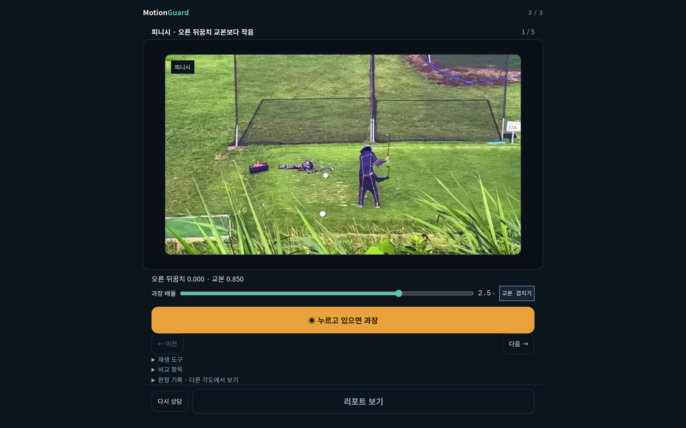
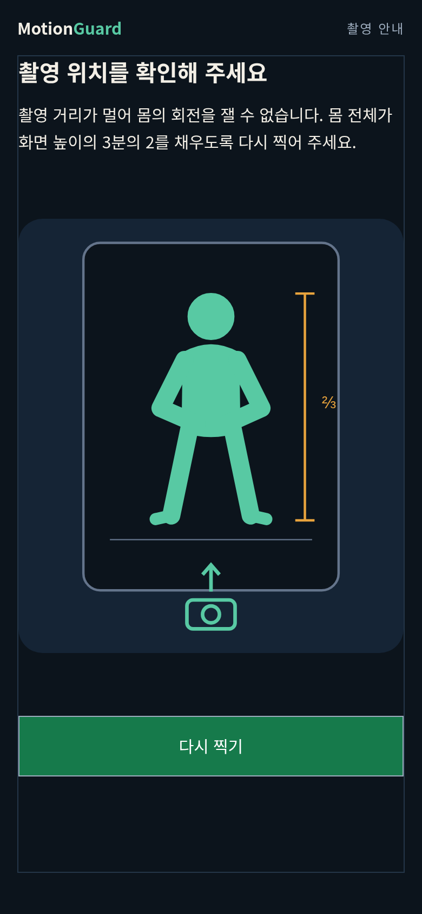
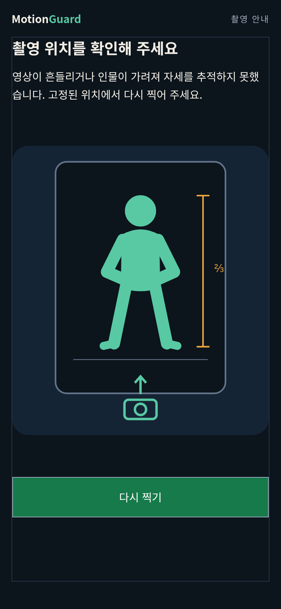
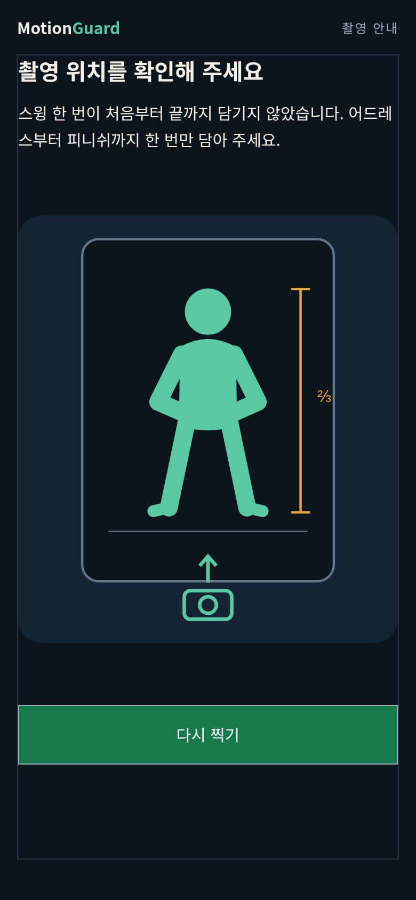
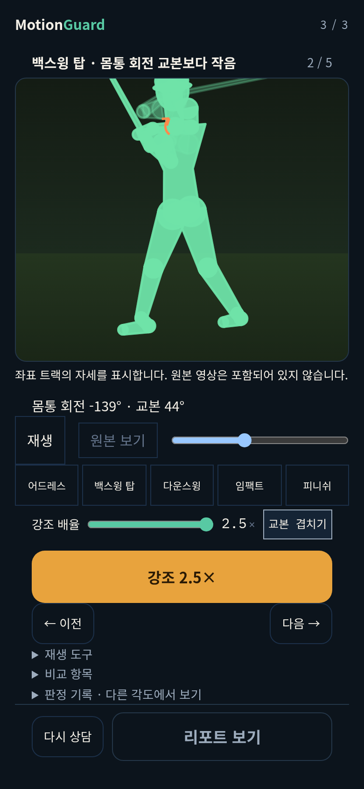
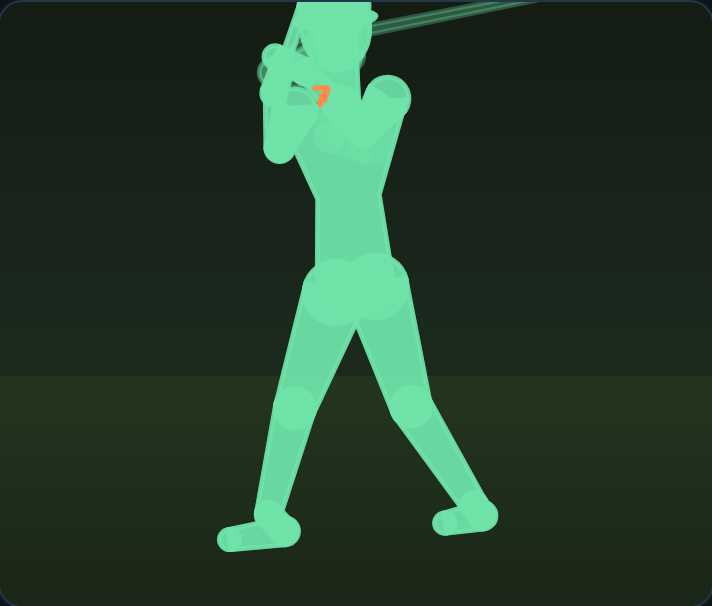
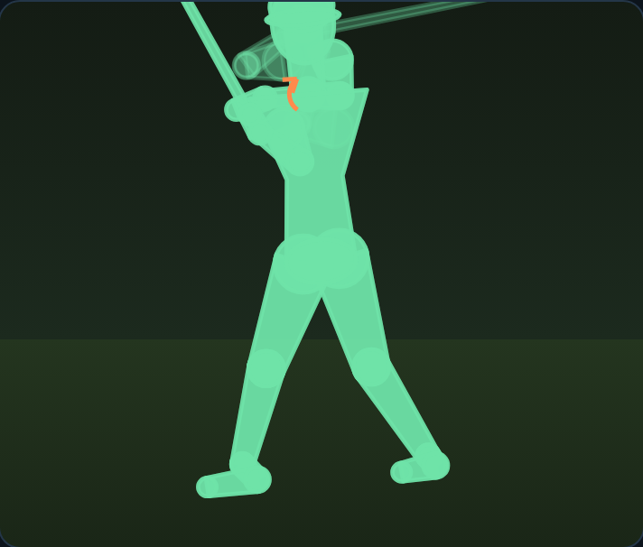

# MOTIONGUARD_BUILD 실측 — 5단계에서 중단

**1~4단계를 통과하고 5단계에서 미통과했습니다. 지시대로 6~9단계는 수행하지 않았습니다.**

- 기준: 사용자가 첨부한 `MOTIONGUARD_BUILD (1).md` 전문. SHA-256 `375474ce984263c91d3410d70797bd9c95dd43f2a2171d4c6ae36e7d68b05755`.
- 최신 기준 브랜치 `feature/swing3d`: `f9c0ca9`에서 시작. 저장소의 동명 정본에는 CSV 컬럼/기존 국면을 설명하는 17줄이 더 있으며 첨부 요구와 충돌하지 않습니다.
- PR #4를 병합하거나 그 브랜치의 화면을 전제로 삼지 않았습니다. 이 변경은 최신 기준 브랜치에 독립적으로 올립니다.
- 단계 5: f118, 2.5× 관절 이동 **33.119763px**. 폭이 정확히 390 CSS px인 캔버스의 1×/2.5× 차이 **2.171846% < 3%**. 캡처의 아바타 머리 상단 잘림도 남아 있습니다.

## 단계 1 — 얼굴 좌표 제외, 회전은 3D

| 항목 | 기준 | 실측 / 판정 |
|---|---|---|
| 좌표 개수 | 22점. 얼굴 11점이 어디에도 없을 것 | 실제 CSV 242×22, world 242×22. 실제 두 영상 각각 270×22(화면/world). 추출·CSV 로드·응답·오버레이 모두 어깨부터 시작. 기존 골프 CSV에 남아 있던 얼굴 516행도 삭제. 통과 |
| 오버레이 | 얼굴에 점이 찍히지 않을 것 (스크린샷) | `build_s1_overlay.png`: 실제 영상 오버레이의 arc 22개, 머리 점 0개. 아바타 머리는 목/몸통으로 생성. 통과 |
| 3D 회전 | 위 CSV 에서 국면별 몸통·골반·X-factor 가 나올 것 | 아래 실제 자동 검출 5국면의 세 값이 모두 산출됨. 통과 |
| 각도 패턴 | 탑에서 X-factor 가 음수(어깨가 더 돌아감), 임팩트에서 양수 | 탑 -33.631878°, 임팩트 +12.658930°. 통과 |
| 각도 크기 | 보고할 것. 맞추려고 조정하지 말 것 | 탑 몸통 -139.340185°, 골반 -105.708307°. 원본 미터 좌표 atan2, 어드레스 차감, unwrap. 축소 계수 없음. 보고 완료 |

| 국면 | 원본 시점 | 몸통 ° | 골반 ° | X-factor ° |
|---|---:|---:|---:|---:|
| address | 81 | 0.000000 | 0.000000 | 0.000000 |
| top | 118 | -139.340185 | -105.708307 | -33.631878 |
| down | 141 | -13.547129 | -12.337386 | -1.209743 |
| impact | 146 | 15.492378 | 2.833448 | 12.658930 |
| finish | 172 | 97.300724 | 72.900973 | 24.399751 |

1단계 회전의 첫 검증은 문서가 독립 관찰한 국면(81/118/141/146/172)에서 했습니다. 이 시점의 기존 자동 국면(36/125/135/146/185)은 틀렸음을 숨기지 않았으며 2단계에서 자동 검출을 바꿨습니다. **국면·회전 판정 코드에는 해당 시점 상수나 샘플 이름 분기가 없습니다.**

MediaPipe 반환에서 신체 인덱스 11~32만 복사하며 world 좌표는 화면 크롭 역변환을 하지 않습니다. 회전은 카메라 폭비로 포기하지 않습니다. world가 없거나 품질이 낮은 관측은 null이며 2D 폭 역산으로 메우지 않습니다. ±180° 연속 통과 및 공통 카메라 heading 변경 테스트도 통과합니다.

lite 계열의 큰 yaw를 실제 회전 정답으로 보정하지 않았습니다. heavy 모델은 실행하지 않았고, 어깨·골반 차이를 별도 `x_factor`로 추가해 원시 회전과 함께 제공합니다. 기존 9개 항목 + X-factor = 10개 계측 항목이며, confidence는 별도 열입니다.

`build_s1_overlay.png`는 1단계 점 제외 확인 시점의 공개 샘플 캡처입니다. **최종 2단계 판정은 그 영상을 no_swing으로 거절**합니다. 사용자의 실내 원본 영상/얼굴 사진은 쓰거나 새로 커밋하지 않았습니다.

## 단계 2 — 국면 검출

| 항목 | 기준 | 실측 / 판정 |
|---|---|---|
| `swing_front_landmarks.csv` | 국면 5개 확정 | **81 / 118 / 141 / 146 / 172**, 통과 |
| 임팩트 검증 | 통과 | 평활 손 높이 차 **0.034535 < 0.06**, 통과 |
| 어드→탑 | 0.30초 이상 | **0.615467초**, 통과 |
| 탑→임팩트 | 0.15 ~ 0.60초 (현재 0.47초) | **0.465759초**, 통과 |
| 다운 위치 | 탑과 임팩트 사이 | **118 < 141 < 146**, 손 높이 절반을 처음 지난 시점. 통과 |
| 기존 두 샘플 | 스윙 구간을 찾지 못하고 `no_swing` 을 낼 것 | 두 영상 실제 2패스 재추출, 각각 **no_swing / no_swing**, phase_frames={}. 통과 |

문서의 fps/12 홀수 창(5)으로 손 위치를 평활하고 중앙 차분 속도를 구했습니다. 가장자리 5개를 0으로 버리고, 중앙값+(95분위−중앙값)×0.35 및 간격/길이/앞뒤 확장 규칙을 적용했습니다. 실제 연속 속도 구간은 f90~157, 확장 후 f81~172입니다. 허용폭이나 fps를 맞추지 않았습니다.

임팩트 높이 검증 실패 시 `impact_verified:false`, `main_phase_frames`는 어드레스/탑/다운스윙/피니쉬 4개만 내며 UI/스틸 목록에서 임팩트를 숨깁니다. 내부 후보는 수치 보간용으로 구분해 남깁니다. 미확인 임팩트를 코칭 후보로 쓰지 않는 단위 검사도 있습니다.

## 단계 3 — 촬영 품질 안내

통과 조건: **세 상태 단위 테스트 + 화면 스크린샷 3장**.

| 상태 | 실측 조건 | 응답 / 화면 / LLM |
|---|---|---|
| too_far | 합성 신체 어깨폭 **25.600px < 60px**, 242/242 채택 | reason=too_far, 지정 문구, 다시 찍기, SVG. g1 제출. analyze 요청 0회 / provider.generate 0회. 통과 |
| tracking_failed | 합성 관측 채택 **0/242** | reason=tracking_failed, 지정 문구, 다시 찍기, SVG. g2 제출. analyze 요청 0회 / provider.generate 0회. 통과 |
| no_swing | 정지 손 합성, 242/242 채택. 별도로 실제 두 영상도 no_swing | reason=no_swing, 지정 문구, 다시 찍기, SVG. g3 제출. analyze 요청 0회 / provider.generate 0회. 통과 |

저품질 관측을 샘플 ID만으로 고정 예시로 바꾸던 자동 예외도 제거했습니다.

세 안내 캡처는 합성 좌표를 **실제 build_track으로 판정한 응답**을 HTTP 경계에 주입했습니다. 실제 영상인 척한 것이 아닙니다. 실제 공개 샘플 두 건의 판정은 [measure.json](mockups/build/measure.json)에 별도로 있습니다. SVG는 사진 없이 새로 그린 전신·정면 카메라 예시입니다. world 회전은 카메라 방향으로 차단하지 않습니다.

## 단계 4 — 점수

| 항목 | 기준 | 실측 / 판정 |
|---|---|---|
| 총점 | 0~100. 값 보고 | **30.04 / 100**. 10개 항목×4국면 = 40개 계측 항목쌍, 통과 |
| 측정 불가 | `excluded` 로 가고 총점에 영향 없을 것 (테스트) | torso를 전부 null 처리한 테스트에서 4개가 excluded로 이동, 남은 값만 재계산한 가중 평균과 정확히 동일. 0점 삽입 없음. 0.29 품질 항목도 제외. 통과 |
| 재현성 | 같은 입력 두 번 돌려 총점 차이 3점 이내 | **차이 0.00점**, 통과 |
| 상수 분리 | 허용폭·가중치가 `reference.js` 에 있을 것 | `SwingReference.scoring.tolerances/weights` 단일 상수. 서버가 같은 JS JSON 상수를 읽음. 통과 |

항목점수는 요청한 max(0, 100−편차/허용폭×100), 총점은 측정된 항목의 가중 평균입니다. 적정/부족/과다 문자열도 제공합니다. 총점은 서버/API 실측이며 결과 화면 디자인은 6단계 전에 중단되어 아직 이식하지 않았습니다. 선수 기준으로 검증된 점수라고 주장하지 않습니다.

## 단계 5 — 개선 포인트 화면: **미통과, 여기서 중단**

| 항목 | 기준 | 실측 / 판정 |
|---|---|---|
| 2.5배 최대 관절 이동 | **20px 이상** (390px 폭) | 정확히 390px 캔버스, f118 **33.119763px**, 통과 |
| 1.0배 vs 2.5배 | 픽셀 차이 ≥ 3% | 정확히 390px 캔버스 **2.171846%**, **미통과** |
| 교본 잔상·각도 호 | 스크린샷에서 구분될 것 | 잔상 .30 / 내 자세 .92, 선택한 몸통 관절에 교본 방향 호/화살표가 보임. 단 **머리·클럽 상단이 잘림**, 전체 표현 완료 아님 |
| 부호 | 과장 방향 = 측정 방향. 교본 초과 반전 없음 | Node 4개 검사: 양/음, 0 부근 연속성, 1× 동일성, 선택 항목만 변경. 통과 |
| 재생 | 누르면 돌아가고 바로 멈춰 이동할 것 | 실제 22점 CSV, 재생 f118→f133, 정지 후 구간 바로 f141 이동, 180ms 후에도 f141 유지. 통과 |

390×844 실제 화면(DPR 2)의 여백/테두리를 뺀 캔버스는 356×302 CSS px였습니다. 이 화면에서도 이동 **33.119763px**, 픽셀 차이 **2.379269%**로 미통과입니다. 별도 424px 뷰포트에서 캔버스가 정확히 390×302px인지 검증했으며, 위 표의 2.171846%는 그 캔버스입니다. 단순 화면 크기 혼동을 피하려고 둘 다 보고합니다.

픽셀 차이는 같은 f118에서 전체 캔버스 RGBA 중 차이가 8을 넘는 픽셀 비율로 보수적으로 셌습니다. [1× 캔버스](mockups/shots/build_s5_canvas_1x.png) / [2.5× 캔버스](mockups/shots/build_s5_canvas_25x.png)를 함께 제출합니다. 3% 임계값, 배율, fps 또는 관절 값은 통과시키려고 변경하지 않았습니다.

22점에서 머리/몸통을 그리며, 어깨 부착점 변위 제한은 문서대로 뼈 길이 40%로 올렸습니다. 점과 원본의 시간축은 같은 바를 사용합니다. 테스트 CSV에는 원본 영상이 없으므로 원본 버튼을 비활성화하고 그 사실을 표시합니다. 사용자의 원본 영상을 새로 만들거나 재구성 영상으로 가장하지 않았습니다.

**정지 후 이동은 검증했지만, 개선 포인트가 충분히 보이는 완성품은 아닙니다.** 5단계 미통과 상태이므로 6~9단계를 진행하지 않았습니다.

## 미진행 단계 — 수치 없음

| 단계 | 조건 | 상태 |
|---|---|---|
| 6 화면과 디자인 | 1~5 화면 모두 두 폭 빈 띠 ≤20%, 폭 분기 0, 4번 아바타 | **미실시**. tokens/design_system 전면 이식, 5개 화면 캡처와 pxgap 수치 없음 |
| 7 리포트 | 1페이지 총점·고민·확인한 것, 금지 문자열/0차이 검사, report.pdf, A4 18mm | **미실시**. 신규 고객 표/그림 리포트 및 report.pdf 없음 |
| 8 누적과 예상 타수 | 동일 profile 2회 비교, 첫 회 비교 없음, 개인정보 제외, 타수 재현성/문구, 고른 연습 영상 | **미실시**. 신규 profile/타수/drills 구현 없음 |
| 9 테스트와 제출 | 전체 회귀 및 15장 최종 캡처 | **완료 주장 안 함**. 구현한 1~5단계의 단위/브라우저 검사와 중단 PR만 제출 |

기존 `tests/mvp_browser.py`의 9단계 전면 개정은 미실시입니다. 이번 단계별 `build_browser.py`에서는 실제 22점 응답과 렌더를 검증합니다.

기존 PDF/YouTube/보조 3D 코드는 보존했습니다. 새 기준의 해당 단계가 완료된 것은 아닙니다. 고객 노출 문자열의 금지어는 기존 화면에서도 `개선 포인트`/`강조`로 바꿨습니다.

## 실행 결과

```bash
cd swing3d
python -m pytest tests/ -q
node tests/test_comparison.cjs
python tests/measure_build.py
python tests/build_browser.py  # 5단계 실제 픽셀 조건에서 exit 1
```

```text
...........................................                 [100%]
43 passed, 13 subtests passed in 6.92s
```

```text
✔ deficits approach zero continuously without reversing either direction (10.512127ms)
✔ address offsets and actual phase indices anchor all measured channels (0.20571ms)
✔ zero stays zero and the sign and slope are continuous at the start of exaggeration (37.700255ms)
✔ exaggeration is exact at 1×, eases at the range and alters only its channel (0.515777ms)
ℹ tests 4
ℹ suites 0
ℹ pass 4
ℹ fail 0
ℹ cancelled 0
ℹ skipped 0
ℹ todo 0
ℹ duration_ms 55.85189
```

**실측 브라우저 게이트는 실패합니다.** 단위 테스트 녹색을 최종 통과로 바꾸지 않았습니다.

```text
expect(received).toBeGreaterThanOrEqual(expected)

Expected: >= 0.03
Received:    0.021718458142299203
    at captureRawStack (/opt/codex/runtimes/codex-primary-runtime/dependencies/node/node_modules/playwright-core/lib/coreBundle.js:9681:17)
    at callMatcherAsStep (/opt/codex/runtimes/codex-primary-runtime/dependencies/node/node_modules/playwright/lib/matchers/expect.js:13310:57)
    at Object.toBeGreaterThanOrEqual (/opt/codex/runtimes/codex-primary-runtime/dependencies/node/node_modules/playwright/lib/matchers/expect.js:13300:23)
    at /workspace/motionguard-build/swing3d/tests/build_browser.cjs:49:43 {
  matcherResult: {
    message: 'expect(received).toBeGreaterThanOrEqual(expected)\n' +
      '\n' +
      'Expected: >= 0.03\n' +
      'Received:    0.021718458142299203',
    pass: false,
    name: 'toBeGreaterThanOrEqual'
  }
}
```

Python 3.12 / MediaPipe 0.10.21 / Chromium 156, API 키 없는 데모 경로에서 측정했습니다. 외부 Gemini 실서비스 호출을 했다는 뜻이 아닙니다. [전체 수치](mockups/build/measure.json), [브라우저 수치](mockups/build/browser.json), [브라우저 출력](mockups/build/browser.txt), [pytest 출력](mockups/build/pytest.txt).

## 남은 실행 웹 미디어 쿼리 전체

| 위치 | 쿼리 | 성격 |
|---|---|---|
| `web/instrument.js:62` | `JS (pointer: fine)` | 키보드 입력/설명, 폭 분기 아님 |
| `web/report.css:35` | `print` | A4 인쇄용 구조 |
| `web/report.css:43` | `screen` | 화면용 리포트, 인쇄와 구분 |
| `web/report.css:47` | `screen` | 화면용 리포트, 인쇄와 구분 |
| `web/report.css:64` | `print` | A4 인쇄용 구조 |
| `web/report.css:66` | `print` | A4 인쇄용 구조 |
| `web/report.css:78` | `screen` | 화면용 리포트, 인쇄와 구분 |
| `web/style.css:77` | `(prefers-reduced-motion: reduce)` | 스크롤 동작, 폭 분기 아님 |
| `web/style.css:143` | `(pointer:coarse)` | 키보드 입력/설명, 폭 분기 아님 |

폭 조건을 쓰는 미디어 쿼리는 0개입니다. 다만 6단계의 전체 디자인/빈 띠 측정을 수행한 것은 아닙니다.

## 제출 화면

[build_s1_overlay.png](mockups/shots/build_s1_overlay.png)



[g1_too_far.png](mockups/shots/g1_too_far.png)



[g2_tracking.png](mockups/shots/g2_tracking.png)



[g3_no_swing.png](mockups/shots/g3_no_swing.png)



[build_s5_point.png](mockups/shots/build_s5_point.png)



[build_s5_canvas_1x.png](mockups/shots/build_s5_canvas_1x.png)



[build_s5_canvas_25x.png](mockups/shots/build_s5_canvas_25x.png)


