# WEB 03 — 2026-11-19 실측 결과

`CODEX_WEB_03.md`의 맨 끝 정정까지 다시 읽고 PR #3을 병합했습니다. 병합 커밋은 `e174211cbc828d048b02158d66e2a6868533273e`입니다. 이후 추가된 문서 커밋 `7fb36766ad45027d1f58c397c421d01cefef6e32`도 보존했습니다. 이 변경은 `feature/swing3d`를 대상으로 합니다.

**1단계는 통과**이며 어깨폭 기준을 추론 입력 **60px**로 적용했습니다. 영상 원본 시간과 국면 규칙은 유지했습니다. 2~6단계를 구현·측정했습니다. 자동 검증과 화면 캡처는 사용자 화면 승인과 구별합니다.

## 1단계 — 정정된 통과 조건 재측정

| 항목 | 기준 | golf_swing.mp4 | golf_swing_portrait.mp4 |
|---|---|---|---|
| 2패스 어깨폭 **픽셀** | 추론 입력 기준 **60px 이상** (`shoulder_width_max × resized_side`) | 0.119160072 × 640 = **76.262px · 통과** | 0.119083407 × 640 = **76.213px · 통과** |
| 채택 프레임 비율 | 70% 이상 | 270/270 = 100.00% · 통과 | 270/270 = 100.00% · 통과 |
| 국면 확정 | 5개 모두 | {'address': 4, 'top': 65, 'down': 89, 'impact': 113, 'finish': 132} · 5/5 통과 | {'address': 3, 'top': 77, 'down': 94, 'impact': 112, 'finish': 131} · 5/5 통과 |
| `top → impact` | **상한 없음.** 값을 보고만 할 것 (영상 재생속도를 알 수 없음) | 1.601602초 · 원본 시간 | 1.167835초 · 원본 시간 |
| `down` 위치 | `top→impact` 의 25%~75% | 50.000% · 통과 | 48.571% · 통과 |
| `address` 손 y | `top` 손 y 보다 클 것 | 0.236416 > 0.203947 · 통과 | 0.245676 > 0.220514 · 통과 |
| 좌표 역변환 오차 | 2패스를 원본으로 되돌린 어깨 중점이 1패스 어깨 중점과 **0.05 이내** | 최대 0.024854 · 통과 | 최대 0.013550 · 통과 |
| 몸통·골반 | 탑에서 0.0°가 **아닐 것** (측정 불가면 `null`) | null / null · oblique, 통과 | null / null · oblique, 통과 |
| 처리 시간 | 기존의 1.6배 이하 | 기존 중앙값 4.714048s → 6.816298s, **1.4460배 · 통과** | 기존 중앙값 4.535269s → 6.400421s, **1.4113배 · 통과** |
| 기존 테스트 | `pytest tests/ -q` 통과 | 44 passed + 17 subtests · 통과 | 동일 실행 · 통과 |

시간은 같은 머신의 워밍업 후 각 3회 중앙값입니다. 원시 시간·좌표·각도·판정은 [measure.json](mockups/measurements/measure.json)에 있습니다. 두 샘플 모두 실제 재추출했으며 샘플별 예외를 추가하지 않았습니다.

## 2단계 — 촬영 품질 안내

| 항목 | 기준 | 실제 결과 |
|---|---|---|
| 네 상태 단위 테스트 | 각각 합성 좌표로 재현되고 올바른 `unusable_reason` 반환 | too_far: 26.453px, 258/258 채택 → too_far. tracking_failed: 0/30 채택 → tracking_failed. no_swing: 132.267px, 258/258 채택, 정지 손 → no_swing. oblique: 합성 폭비와 확정 국면 → oblique. 4/4 통과 |
| `oblique` 동작 | 분석이 계속되고 `torso`/`hips` 만 `null` | 합성 테스트의 9개 중 해당 2개만 null, 나머지 7개 유효. 실제 샘플도 usable=true, oblique, 분석/리포트 완료 · 통과 |
| 화면 | 네 상태 각각 스크린샷 제출 | g1~g3: 합성 좌표에서 실제 판정한 응답을 HTTP 경계에 주입. g4: 실제 샘플 사선 촬영 결과. 4/4 제출 |
| LLM 호출 | `usable:false` 일 때 호출 전에 차단될 것 | 합성 3개 화면의 analyze 요청 0회, provider.generate 0회 단위 검사. 1패스 인물 미검출 ExtractionError도 안내 응답으로 전환 · 통과 |

SVG는 [capture-guide.svg](mockups/capture-guide.svg)에 새로 그렸습니다. 전신 실루엣 약 192px / 촬영창 288px, 약 2/3 높이이며 정면 카메라를 표시합니다. 문서의 네 안내 문구를 그대로 사용합니다.

## 3단계 — 과장 시각화

| 항목 | 기준 | 실측 |
|---|---|---|
| 2.5배 최대 관절 이동 | **20px 이상** (390px 폭 캔버스) | **45.5057px**, 390 CSS px, DPR 2 · 통과 |
| 1.0배 vs 2.5배 | 같은 프레임 두 캔버스의 픽셀 차이 ≥ 3% | **4.2879%** (f132, RGBA 차이가 8을 넘는 픽셀을 보수적으로 계수) · 통과 |
| 교본 잔상 | 과장 자세와 구분되어 보일 것 (스크린샷) | m3/d3의 mint alpha 0.30 / 0.92, 골반 중점 오차 0px · 통과 |
| 각도 호 | 차이 나는 관절에 그려질 것 (스크린샷) | 선택한 스윙각의 호/교본 방향 화살표, 반지름 22.0848px(모바일) / 26.6458px(PC), 뼈 길이의 45% · 통과 |
| 부호 | 과장 방향 = 측정 방향, 교본 초과 반전 없음 | Node 4개 테스트 통과: 양/음 방향·0 근처 연속성·1× 동일성·선택한 항목만 변경 |
| 아바타 | 머리·몸통 포함 | 실제 33점에서 사람형 머리/몸통/팔다리/클럽 렌더, m3/d3 확인 · 통과 |

모바일 390×844 화면에서 여백을 뺀 실제 무대 358×276px도 이동 **45.3415px**, 픽셀 차이 **4.1983%**였습니다. PC 무대 840×333px는 이동 **54.7054px**, 픽셀 차이 **2.1461%**입니다. **PC에도 같은 3% 기준을 별도로 적용하면 미통과**입니다. 위 표는 문서의 390px 캔버스 기준입니다.

1.0~2.5× 슬라이더, 누르는 동안만 과장(놓으면 실제 좌표와 완전히 동일), 5개 국면 정확한 원본 시점 이동, ±0.4초 반복, 0.5배속을 확인했습니다. 어깨 부착점 제한은 뼈 길이 40%이며 발 접지·신체 비율 제약을 유지합니다. **무릎/뒤꿈치/좌우 이동의 물리적 자세 변형은 기존 접지 제약으로 제한됩니다. 이 항목까지 모두 눈에 띄게 변형된다고 주장하지 않습니다.**

### 추가 확인 — 몸통 최대값 위치

| 항목 | 기준 | golf_swing.mp4 | golf_swing_portrait.mp4 |
|---|---|---|---|
| 몸통 최대값 위치 | `top` 에서 최대인지 확인해 보고. 아니면 어느 국면인지와 값 | 5국면 양의 최대: top **17.0876°**, down 15.9985°. address~impact 전체 양의 최대는 f34 **32.0091°**로 탑 f65가 아님 | 5국면 양의 최대: **down 19.3086°**, top 17.7703°. address~impact 전체 양의 최대는 f30 **32.6997°**로 탑 f77이 아님 |

위 값은 사선 영상의 폭 역산 **진단 전용**이며 코칭 값은 torso/hips 모두 null입니다. 절댓값 최대가 아니라 부호를 보존한 백스윙 방향의 양의 최대를 보고했습니다. 두 영상 모두 전체 구간 최대는 탑이 아닙니다. 국면 오류인지 역산 지연인지 이 숫자만으로 확정하지 않았으며 임계값을 조정하지 않았습니다.

## 4단계 — 화면 구조와 디자인

| 화면 | 390×844 (픽셀) | 1440×900 (픽셀) |
|---|---|---|
| ① 업로드·상담 | 최대 빈 띠 44 / 1688px = **2.6066% · 통과** | 최대 빈 띠 40 / 1800px = **2.2222% · 통과** |
| ② 요약 확인 | 최대 빈 띠 48 / 1688px = **2.8436% · 통과** | 최대 빈 띠 48 / 1800px = **2.6667% · 통과** |
| ③ 비교 | 최대 빈 띠 56 / 1688px = **3.3175% · 통과** | 최대 빈 띠 56 / 1800px = **3.1111% · 통과** |
| ④ 리포트 | 최대 빈 띠 61 / 1688px = **3.6137% · 통과** | 최대 빈 띠 62 / 1800px = **3.4444% · 통과** |

`tools/pxgap.py` 원본 함수로 실제 DPR 2 PNG의 최대 수평 빈 띠를 측정했습니다. 모든 값이 20% 이하입니다. 이는 해당 도구가 정의한 최대 빈 띠이며 전체 배경 면적 비율은 아닙니다. [pxgap.json](mockups/measurements/pxgap.json).

본문 max 840px, 양옆 최소 16px. 같은 세로 셸·같은 기능·같은 조작이며 폭에 따른 레이아웃 분기 **0개**입니다. 늘어나는 곳은 영상/대화, 요약 마지막 칸, 비교 무대, 리포트 본문입니다. 과장 56px, 주요 52px, 보조 48px, 국면 버튼 44px. 두 비교 스크린샷 모두 실제 아바타를 포함합니다.

### 실행 웹 코드에 남은 미디어 쿼리 전체

| 위치 | 쿼리 | 성격 |
|---|---|---|
| `web/style.css` | `prefers-reduced-motion:reduce` | 스크롤 애니메이션 비활성, 레이아웃 변경 없음 |
| `web/style.css` | `pointer:coarse` | 키보드 안내 숨김, 포인터 설명만 변경 |
| `web/report.css` | `print` 첫 블록 | A4 인쇄, 화면 셸을 인쇄 흐름으로 전환. 화면 폭 분기 아님 |
| `web/report.css` | `print` 두 번째 블록 | 인쇄 이미지 2열, 최대 폭 제거, 중복 비교 이미지 생략. 화면 폭 분기 아님 |
| `web/instrument.js` | `matchMedia('(pointer: fine)')` | PC Enter 전송/IME 보호, 레이아웃 변경 없음 |

`rg -n '@media|matchMedia' web --glob '*.css' --glob '*.js'`로 조사했습니다. `mockups/`의 과거 시안은 실행 웹 코드가 아닙니다.

## 5단계 — 리포트를 고객 언어로

| 항목 | 기준 | 실측 |
|---|---|---|
| 1페이지 | 1·2번이 들어갈 것 | 승인한 고민 원문 + 백스윙 탑 실제 42.7° / 참고 120.0°를 답 문장에 포함. PDF 1페이지 텍스트 추출 확인 · 통과 |
| 고칠 점 | 4개 이상이면 심각도 상위 3개만 | 실제 샘플 개선 3개, 잘한 점 2개. 합성 5개 후보(0차이 포함)에서 high 2개+medium 1개만 선택하는 테스트 · 통과 |
| 본문 문자열 검사 | `신뢰도`, `프레임`, `정규화`, `채널` 이 본문에 없을 것 (테스트) | 모바일/PC customer-body 각각 0개 + 서버 생성 본문 단위 검사 · 통과 |
| 0 차이 항목 | 피드백 목록에 없을 것 (테스트) | 실제 차이 0인 impact_swing 제외, 합성 0차이 제외. 잘한 점도 0차이를 제외 · 통과 |
| PDF | 실제 샘플로 만든 1부를 `mockups/shots/w03_report.pdf` 로 제출 | 실제 샘플·수정 승인한 고민으로 생성. 4페이지, 각 개선 항목 원본 1장+과장 1장 = 6장 · 통과 |
| 인쇄 | A4 세로, 여백 18mm, 페이지 넘김에서 항목이 잘리지 않을 것 | A4 594.96×841.92pt, CSS @page 18mm. 원본/과장/설명/연습법을 한 카드로 유지. 텍스트 추출: 두 카드 2쪽, 마지막 카드 3쪽, 부록만 4쪽. 실제 PDF 렌더 확인 · 통과 |

[PDF 열기](mockups/shots/w03_report.pdf). API 키 없이 데모 모드로 실행했습니다. 외부 Gemini 실서비스 호출 결과를 검증한 것은 아닙니다. 기존 Gemini 요청·근거 검증 단위 테스트는 통과했습니다.

## 6단계 — 회귀와 제출

| 테스트 | 내용 | 실제 결과 |
|---|---|---|
| `test_crop_roundtrip` | 2패스 좌표 역변환 오차 0.05 이내 | 기하 왕복 오차 <1e-12, 실제 교차 패스 최대 0.024854/0.013550 · 통과 |
| `test_shoulder_width` | 두 샘플 추론 입력 어깨폭 ≥60px (정정 반영) | 76.262 / 76.213px · 통과 |
| `test_phases_resolved` | 두 샘플 5국면+간격 조건 | 각각 5/5, down 50.00% / 48.57% · 통과 |
| `test_guidance_states` | 네 상태 올바른 reason | 4/4 상태 재현 · 통과 |
| `test_oblique_partial` | 분석 계속, torso/hips만 null | 2 null / 7 available · 통과 |
| `test_exaggeration_px` | 2.5배 관절 이동 ≥20px | 브라우저 390px 무대 45.5057px · 통과 |
| `test_report_language` | 금지 문자열·0차이 제외 | 단위 검사 + 모바일/PC 실제 DOM 각각 0개 · 통과 |
| `mvp_browser.py` | 실제 33점/상담/승인/비교/리포트 | 2턴, 한글 IME/빈 Enter/Shift+Enter, 승인 전 추출 0, 요약 4칸 수정, 정확한 5국면 이동, 0.5×·반복, hold/release, 보조 3D와 WebM 다운로드, YouTube, PDF, JS 오류 0. 두 폭 통과 |

```text
............................................            [100%]
44 passed, 17 subtests passed in 23.51s
```

```text
✔ deficits approach zero continuously without reversing either direction (8.76895ms)
✔ address offsets and actual phase indices anchor all nine channels (0.233272ms)
✔ zero stays zero and the sign and slope are continuous at the start of exaggeration (58.461843ms)
✔ exaggeration is exact at 1×, eases at the range and alters only its channel (0.557801ms)
ℹ tests 4
ℹ suites 0
ℹ pass 4
ℹ fail 0
ℹ cancelled 0
ℹ skipped 0
ℹ todo 0
ℹ duration_ms 74.91546
```

### 명시하는 미통과와 제한

- **PC 넓은 무대의 1×/2.5× 픽셀 차이 2.1461%**: 3%를 PC 전체 면적에도 적용하면 **미통과**. 문서에 명시된 390px 측정은 4.2879%로 통과합니다.
- **몸통의 전체 최대가 탑에 있지 않음**: 가로 f34 / 세로 f30. 세로는 국면끼리 비교해도 다운이 최대입니다. 요청대로 보고하며 별도 교정은 하지 않았습니다.
- **모든 항목의 물리적 변형을 검증한 것은 아님**: 최대 이동/픽셀 게이트는 실제 선택한 `finish_swing`에서 측정했습니다. 무릎/뒤꿈치/좌우 이동은 기존 접지 제약이 남아, 모든 선택 항목에 같은 시각 효과가 난다는 조건으로 보면 **미통과**입니다.
- 키 없는 데모 경로와 mocked Gemini 근거 테스트를 검증했습니다. 실서비스 Gemini 호출은 이번 측정 범위 밖입니다.
- 문서 재현 명령은 `round(None, 2)` 때문에 그대로 실행 시 TypeError입니다. 또한 문서의 원본 시점을 트랙 행으로 바로 쓰는 부분은 시작 오프셋을 빼야 합니다. 원문 명령을 바꾸어 성공한 척하지 않고 아래 원문 실행 결과와 null-safe 추가 진단을 모두 제출합니다.

### 문서 재현 명령 출력 전문

```text
WARNING: All log messages before absl::InitializeLog() is called are written to STDERR
I0000 00:00:1795050192.600149    3154 task_runner.cc:85] GPU suport is not available: INTERNAL: ; RET_CHECK failure (mediapipe/gpu/gl_context_egl.cc:84) egl_initializedUnable to initialize EGL
INFO: Created TensorFlow Lite XNNPACK delegate for CPU.
W0000 00:00:1795050192.652729    3178 inference_feedback_manager.cc:114] Feedback manager requires a model with a single signature inference. Disabling support for feedback tensors.
W0000 00:00:1795050192.670200    3178 inference_feedback_manager.cc:114] Feedback manager requires a model with a single signature inference. Disabling support for feedback tensors.
W0000 00:00:1795050192.711356    3182 landmark_projection_calculator.cc:186] Using NORM_RECT without IMAGE_DIMENSIONS is only supported for the square ROI. Provide IMAGE_DIMENSIONS or use PROJECTION_MATRIX.
I0000 00:00:1795050194.388375    3154 task_runner.cc:85] GPU suport is not available: INTERNAL: ; RET_CHECK failure (mediapipe/gpu/gl_context_egl.cc:84) egl_initializedUnable to initialize EGL
W0000 00:00:1795050194.439523    3203 inference_feedback_manager.cc:114] Feedback manager requires a model with a single signature inference. Disabling support for feedback tensors.
W0000 00:00:1795050194.469716    3204 inference_feedback_manager.cc:114] Feedback manager requires a model with a single signature inference. Disabling support for feedback tensors.
samples/golf_swing.mp4
  usable = True | camera = oblique | 폭비 = 0.5497
  채택 = 270 / 270 | 어깨폭 최대 = 0.11916007172493706 | crop_box = {'x': 0.4203125, 'y': 0.3416666666666667, 'w': 0.2859375, 'h': 0.5083333333333333, 'pixels': [269, 123, 183, 183], 'source_size': [640, 360], 'resized_side': 640, 'padding_per_side': 0.25, 'boundary_limited': False, 'inverse_transform': {'function': 'video_pose.crop_to_original', 'x': 'box.x + x_crop * box.w', 'y': 'box.y + y_crop * box.h', 'z': 'z_crop * box.w'}}
  address ->top         4->  65   2.04s
  top     ->down       65->  89   0.80s
  down    ->impact     89-> 113   0.80s
  impact  ->finish    113-> 132   0.63s
Traceback (most recent call last):
  File "<stdin>", line 15, in <module>
TypeError: type NoneType doesn't define __round__ method
```

### null-safe / 원본 시점 오프셋 적용 추가 진단

실제 두 영상을 다시 추출해 실행했습니다. [실행 스크립트](mockups/measurements/nullsafe.py).

```text
samples/golf_swing.mp4
usable = True camera = oblique 폭비 = 0.5497
채택 = 270 / 270 어깨폭 최대 = 0.11916007172493706 추론 픽셀 = 76.26244590395972
crop_box = {'x': 0.4203125, 'y': 0.3416666666666667, 'w': 0.2859375, 'h': 0.5083333333333333, 'pixels': [269, 123, 183, 183], 'source_size': [640, 360], 'resized_side': 640, 'padding_per_side': 0.25, 'boundary_limited': False, 'inverse_transform': {'function': 'video_pose.crop_to_original', 'x': 'box.x + x_crop * box.w', 'y': 'box.y + y_crop * box.h', 'z': 'z_crop * box.w'}}
address source frame 4 track row 0 {'torso': None, 'hips': None}
top source frame 65 track row 61 {'torso': None, 'hips': None}
down source frame 89 track row 85 {'torso': None, 'hips': None}
impact source frame 113 track row 109 {'torso': None, 'hips': None}
finish source frame 132 track row 128 {'torso': None, 'hips': None}
torso_peak_check = {"source": "width_inverse_diagnostic_only", "eligible_for_coaching": false, "phase_degrees": {"address": 0.0, "top": 17.087563935649342, "down": 15.998512849098972, "impact": -9.966477495805364, "finish": -20.367748591787056}, "max_phase": "top", "peak_frame": 34, "peak_degrees": 32.00905427495525}
samples/golf_swing_portrait.mp4
usable = True camera = oblique 폭비 = 0.5752
채택 = 270 / 270 어깨폭 최대 = 0.11908340737933204 추론 픽셀 = 76.21338072277251
crop_box = {'x': 0.3425925925925926, 'y': 0.4244791666666667, 'w': 0.42824074074074076, 'h': 0.24088541666666666, 'pixels': [148, 326, 185, 185], 'source_size': [432, 768], 'resized_side': 640, 'padding_per_side': 0.25, 'boundary_limited': False, 'inverse_transform': {'function': 'video_pose.crop_to_original', 'x': 'box.x + x_crop * box.w', 'y': 'box.y + y_crop * box.h', 'z': 'z_crop * box.w'}}
address source frame 3 track row 0 {'torso': None, 'hips': None}
top source frame 77 track row 74 {'torso': None, 'hips': None}
down source frame 94 track row 91 {'torso': None, 'hips': None}
impact source frame 112 track row 109 {'torso': None, 'hips': None}
finish source frame 131 track row 128 {'torso': None, 'hips': None}
torso_peak_check = {"source": "width_inverse_diagnostic_only", "eligible_for_coaching": false, "phase_degrees": {"address": 0.0, "top": 17.770276906727535, "down": 19.30860493011163, "impact": -27.528383454204153, "finish": -11.193135835550342}, "max_phase": "down", "peak_frame": 30, "peak_degrees": 32.69973678160482}
```

### 12장 스크린샷 — 실제 앱, DPR 2

[w03_m1_upload.png](mockups/shots/w03_m1_upload.png)

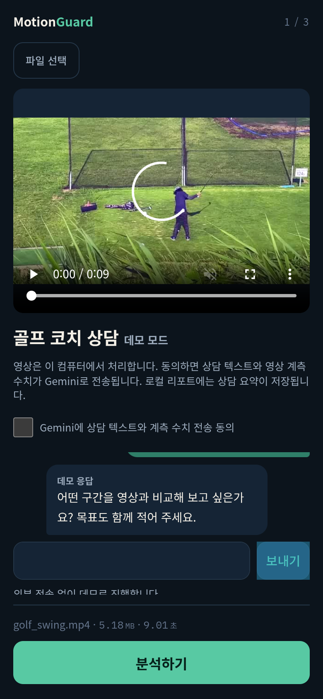

[w03_m2_summary.png](mockups/shots/w03_m2_summary.png)

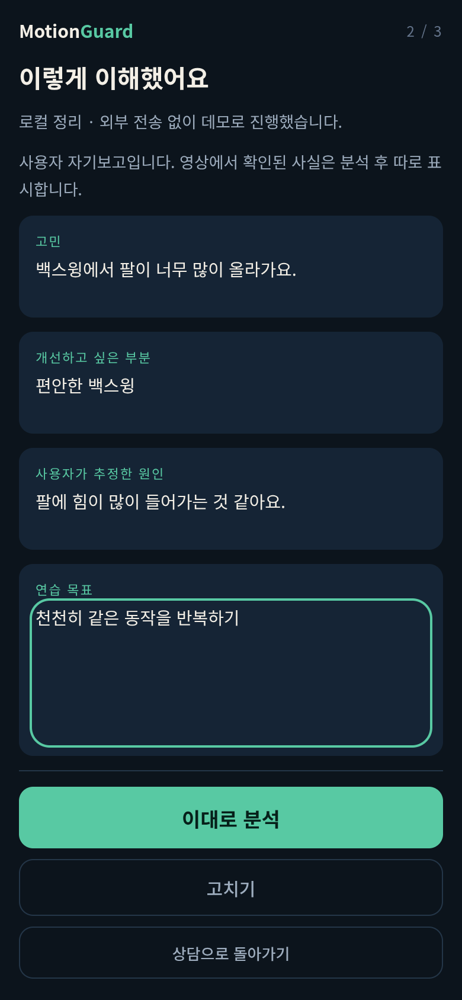

[w03_m3_compare.png](mockups/shots/w03_m3_compare.png)

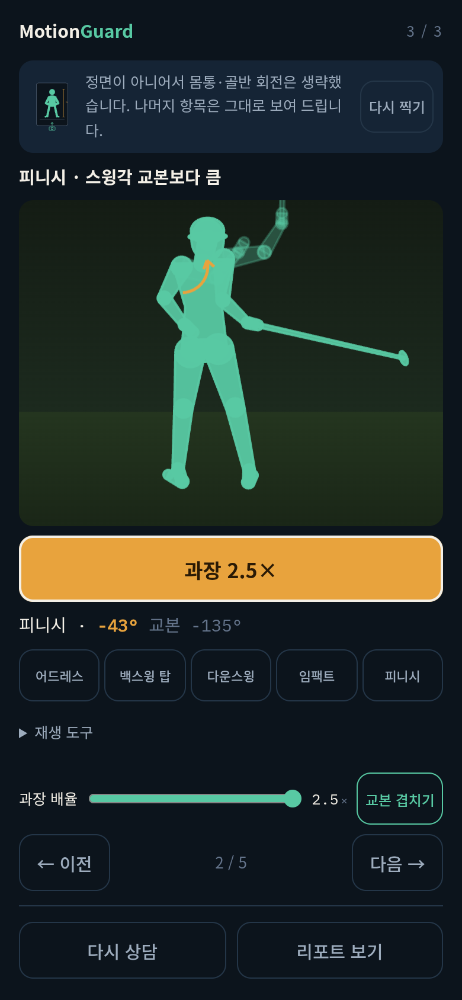

[w03_m4_report.png](mockups/shots/w03_m4_report.png)

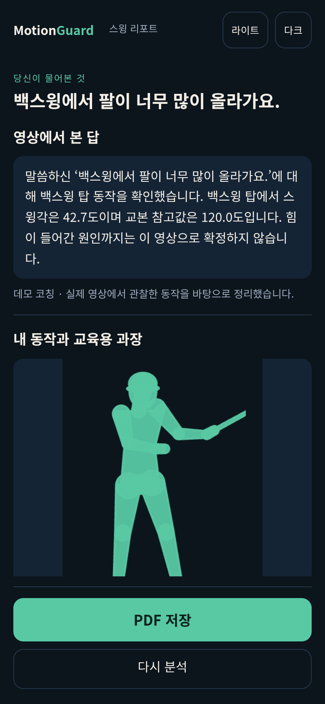

[w03_d1_upload.png](mockups/shots/w03_d1_upload.png)

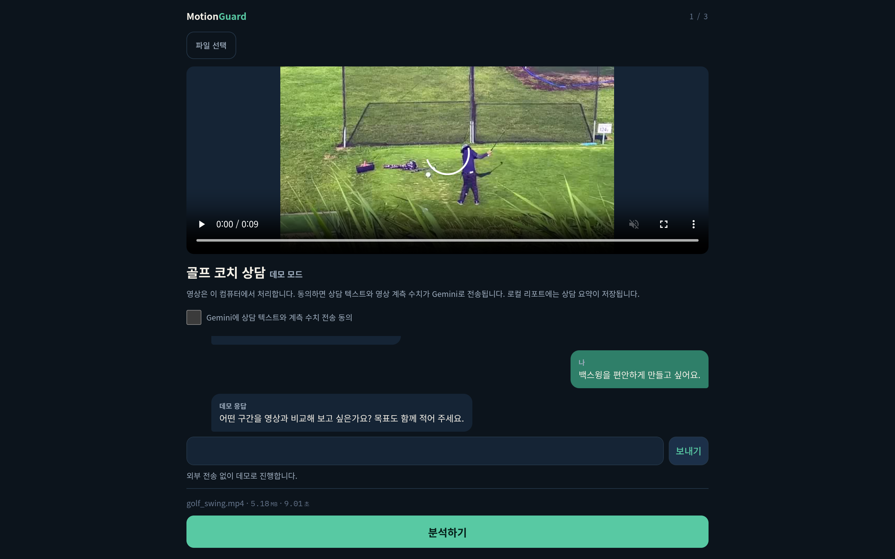

[w03_d2_summary.png](mockups/shots/w03_d2_summary.png)

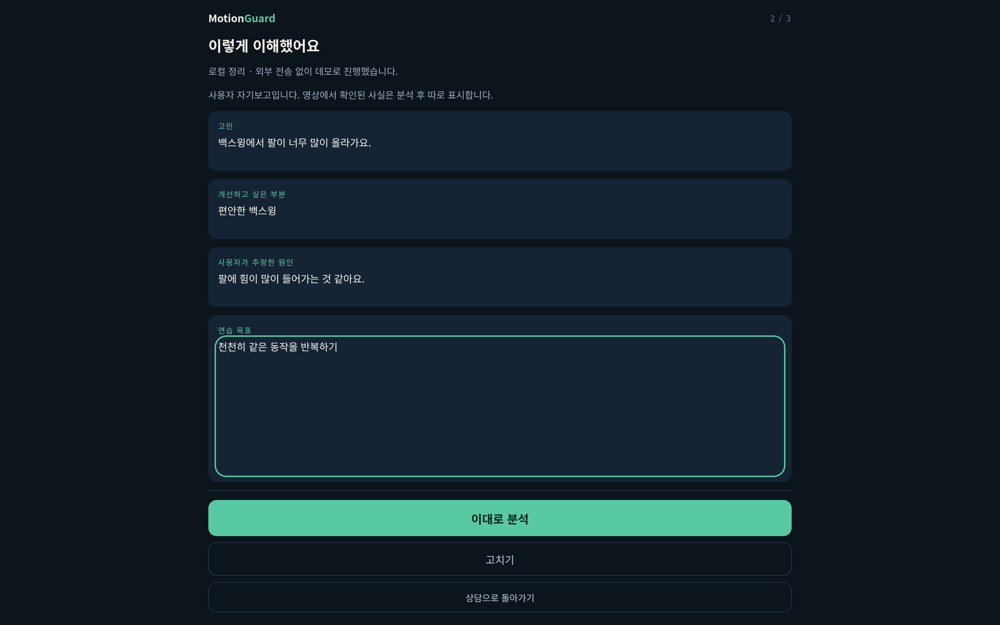

[w03_d3_compare.png](mockups/shots/w03_d3_compare.png)

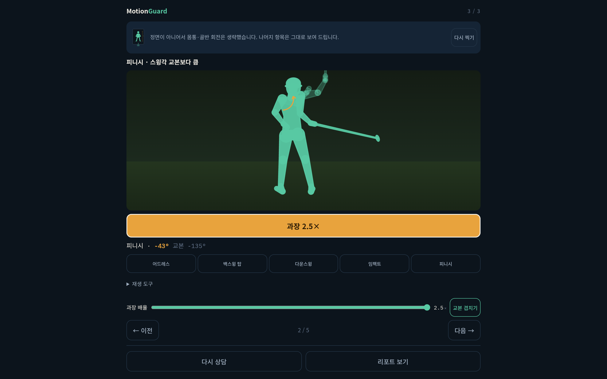

[w03_d4_report.png](mockups/shots/w03_d4_report.png)

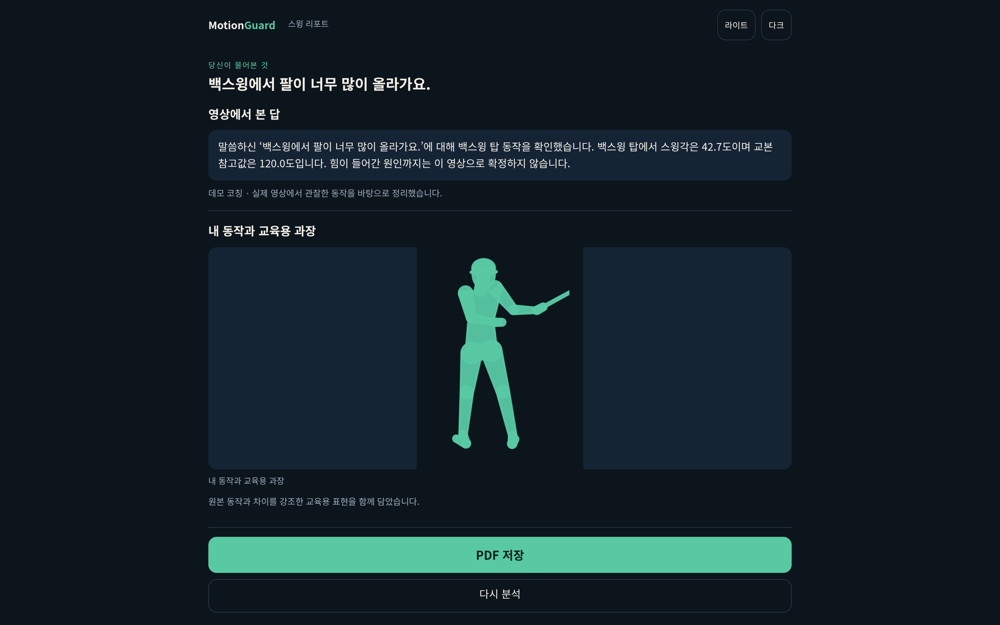

[w03_g1_too_far.png](mockups/shots/w03_g1_too_far.png)

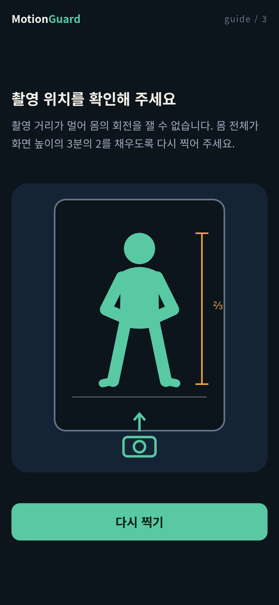

[w03_g2_tracking.png](mockups/shots/w03_g2_tracking.png)

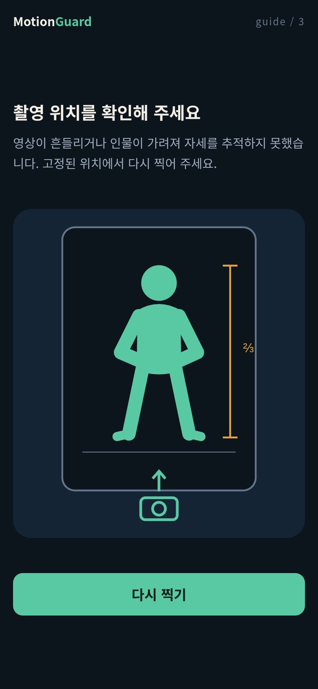

[w03_g3_no_swing.png](mockups/shots/w03_g3_no_swing.png)

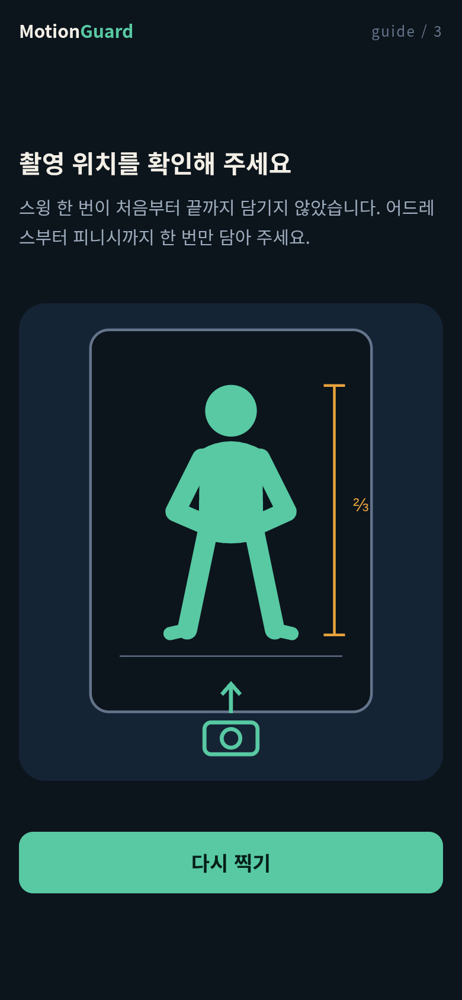

[w03_g4_oblique.png](mockups/shots/w03_g4_oblique.png)


